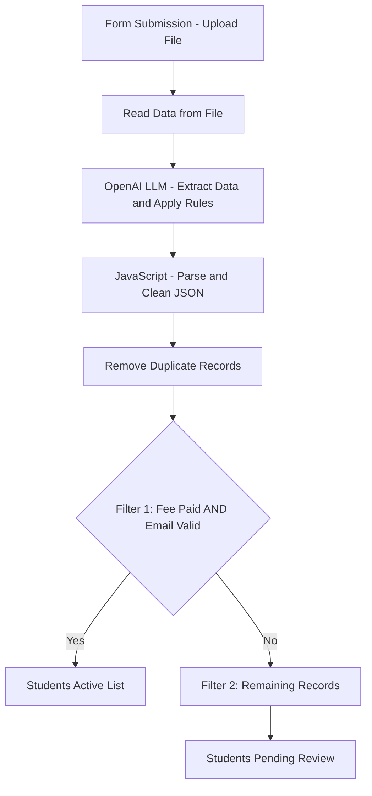

# Student Data Processing and Validation Workflow using n8n & OpenAI

## 📌 Project Overview

This project automates student data processing using **n8n and OpenAI LLM**. It accepts an uploaded file through a form, extracts student information, applies validation rules, cleans and parses the output using JavaScript, removes duplicate records, and generates two separate reports:

1. **Students Active List** – Students whose fees are paid and whose email is valid.
2. **Students Pending Review** – Students who do not meet the active student criteria and require further review.

The workflow demonstrates how AI-powered data extraction can be combined with traditional JavaScript processing and rule-based filtering to automate data management.

## 🎯 Objectives

- Automate student data ingestion through a form submission.
- Extract structured student information using OpenAI LLM.
- Apply business rules to determine fee payment and email validity.
- Parse and clean AI-generated JSON using JavaScript.
- Identify and remove duplicate student records.
- Separate active students from records requiring review.
- Produce structured reports for downstream processing.

## 🏗️ Workflow Architecture



## ⚙️ Workflow Steps

### 1. Form Submission and File Upload

The workflow starts when a user submits a form and uploads a student data file.

**Purpose:**
- Provide a simple interface for submitting student records.
- Trigger the automated workflow.
- Pass the uploaded file to the subsequent processing nodes.

### 2. Read Data from File

The uploaded file is processed to retrieve the source student data.

**Purpose:**
- Read the contents of the uploaded file.
- Make the source data available to the AI processing stage.
- Prepare the input for structured data extraction.

### 3. OpenAI LLM – Data Extraction and Rule Application

The extracted source data is sent to an OpenAI language model through the n8n Basic LLM Chain.

The LLM extracts student details and applies the specified business rules.

**Example output fields:**

| Field | Description |
|---|---|
| Student_ID | Unique student identifier |
| Name | Student name |
| Email | Student email address |
| Phone | Student contact number |
| Course | Enrolled course |
| Fee_Paid | Fee payment status |
| City | Student city |
| Enrolled_Date | Student enrollment date |
| Email_Valid | Email validity status |

**Purpose:**
- Convert source data into a structured format.
- Extract the required student attributes.
- Apply the defined rules for fee status and email validity.
- Return the results in JSON format.

### 4. JavaScript – Parse and Clean JSON

The AI-generated response is passed to an n8n Code node containing custom JavaScript.

The code handles Markdown code fences, parses the JSON, normalizes field values, and produces clean structured records.

**Processing includes:**
- Removing Markdown JSON wrappers such as ` ```json `.
- Parsing the response into valid JSON objects.
- Trimming unwanted whitespace.
- Normalizing email casing and boolean values.
- Standardizing the expected field structure.
- Preparing individual student records for downstream processing.

This step helps ensure consistent data handling before applying the final filters.

### 5. Remove Duplicate Records

The cleaned student records pass through a deduplication step.

**Purpose:**
- Identify duplicate student records.
- Retain one record for each student according to the configured matching criteria.
- Prevent duplicate entries in the generated reports.

**Recommended deduplication key:** `Student_ID`, provided that it uniquely identifies each student.

### 6. Filter 1 – Students Active List

The first filter identifies students who satisfy both business conditions:

- `Fee_Paid = true`
- `Email_Valid = true`

Only records satisfying **both conditions** are routed to the Students Active List.

**Business rule:**

```text
IF Fee_Paid = true AND Email_Valid = true
THEN Student Status = Active
```

The resulting records form the **Students Active List** report.

### 7. Filter 2 – Students Pending Review

Records that do not satisfy both active-student conditions are routed to the Students Pending Review report.

These include students who meet one or both of the following conditions:

- Fees are not paid.
- Email is invalid.

**Business rule:**

```text
IF Fee_Paid != true OR Email_Valid != true
THEN Student Status = Pending Review
```

This report helps identify records requiring follow-up, such as fee collection, email correction, or manual verification.

## 📊 Expected Outputs

### Output 1: Students Active List

Contains student records where fees are paid and the email is marked valid.

| Student_ID | Name | Course | Fee_Paid | Email_Valid |
|---|---|---|---|---|
| STU1001 | Manoj K | Python | true | true |

### Output 2: Students Pending Review

Contains student records that fail at least one of the active-student criteria.

| Student_ID | Name | Course | Fee_Paid | Email_Valid |
|---|---|---|---|---|
| STU1002 | Priya S | Java | false | true |
| STU1003 | Ravi M | Python | true | false |

*The records above are illustrative examples.*

## 🛠️ Technology Stack

- **n8n:** Workflow automation and orchestration.
- **OpenAI LLM:** Student data extraction and rule-based classification.
- **JavaScript:** JSON parsing, data cleaning, and normalization.
- **n8n Filter Nodes:** Business rule evaluation and record routing.
- **File Processing:** Reading uploaded student data and preparing reports.

## 🚀 How to Execute

1. Import or open the workflow in n8n.
2. Configure the form trigger and file-reading nodes.
3. Configure OpenAI credentials for the LLM node.
4. Review the LLM prompt and business rules.
5. Configure the JavaScript Code node.
6. Configure duplicate removal using the chosen unique key.
7. Verify the filter conditions for active and pending-review records.
8. Configure the destination nodes to save or export both reports.
9. Submit a test file through the form.
10. Validate the two reports against the source data.

## ✅ Validation and Testing

Test the workflow using records that cover all combinations of fee and email status.

| Fee_Paid | Email_Valid | Expected Report |
|---|---|---|
| true | true | Students Active List |
| true | false | Students Pending Review |
| false | true | Students Pending Review |
| false | false | Students Pending Review |

Also test duplicate student IDs, malformed LLM output, missing fields, and invalid dates.

## 🔐 Security and Data Quality Considerations

- Store OpenAI credentials securely using n8n credentials.
- Avoid exposing student personal information in public logs or repositories.
- Validate AI-generated values before using them for operational decisions.
- Treat `Email_Valid` as a classification result unless actual email verification is performed separately.
- Ensure that duplicate detection uses a reliable student identifier.
- Review records with missing or ambiguous values instead of automatically treating them as valid.

## 🔮 Future Enhancements

- Support additional file formats and larger datasets.
- Add email notifications for students with pending fees.
- Integrate with a student management system or database.
- Add detailed error handling and execution logging.
- Generate summary statistics for active and pending-review students.
- Introduce human approval for records with uncertain classifications.

## 📝 Conclusion

This project demonstrates an AI-assisted ETL workflow using n8n, OpenAI, and JavaScript. It combines automated file ingestion, intelligent data extraction, structured JSON processing, duplicate removal, and rule-based filtering to produce actionable student reports.

The workflow provides a reusable foundation for automating similar data validation and classification processes in education and other business domains.
